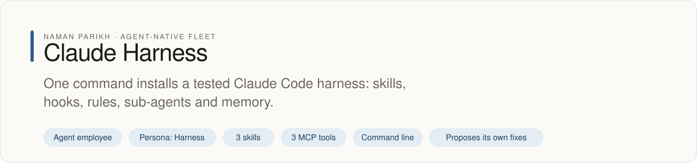
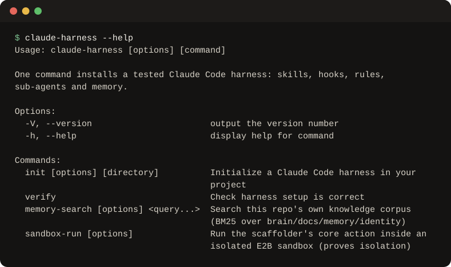

# Claude Harness

<!-- fleet:header:start -->
<p align="center"><picture><source media="(prefers-color-scheme: dark)" srcset="assets/banner-dark.svg"></picture></p>

<p align="center">
<a href="https://github.com/naman10parikh/claude-harness/actions/workflows/ci.yml"></a>
<a href="https://github.com/naman10parikh/claude-harness/releases"></a>
<a href="LICENSE"></a>
<a href="#use-it-from-any-coding-agent"></a>
<a href="https://x.com/naman10parikh"></a>
<a href="https://www.linkedin.com/in/naman-parikh1/"></a>
</p>

<p align="center"><a href="#quick-start">Quick start</a> · <a href="docs/README.md">How it works</a> · <a href="AGENTS.md">AGENTS.md</a> · <a href="llms.txt">llms.txt</a> · <a href="skills/">Skills</a> · <a href="https://github.com/naman10parikh/claude-harness/discussions">Discussions</a> · <a href="https://github.com/naman10parikh">All projects</a></p>

**One command installs a tested Claude Code harness: skills, hooks, rules, sub-agents and memory.**

Claude Harness is an agent employee, a packaged specialist agent with its own skills, memory and tests. It owns one job: the whole harness, as a template. Its persona is Harness. Coding agents use it through its skills, its MCP server and its command line. A scheduled job runs its evals and proposes fixes. A person makes every change.

_Claude Harness is part of an agent-native play for agent-native systems that can eventually be recursively self-improving and evolving, operated by agent employees._

<p align="center"></p>
<!-- fleet:header:end -->

claude-harness copies a tested Claude Code setup into any project: skills, lifecycle hooks, rules,
sub-agents, settings and a memory folder. The next session starts with the project's context loaded,
dangerous commands blocked, and notes that survive context compaction. It comes in three tiers,
installs with one command, and an agent can run it without prompts.

<!-- fleet:use:start -->
## Use it from any coding agent

**Claude Code**: the plugin brings the skills, sub-agents, hooks and MCP server.

```
/plugin marketplace add naman10parikh/claude-harness
/plugin install harness@claude-harness
```

<details><summary>Its MCP server, Codex, Cursor, Gemini CLI, one skill and the command line</summary>

**Its MCP server**, in any MCP client:

```bash
claude mcp add --transport stdio claude-harness -- npx -y -p github:naman10parikh/claude-harness claude-harness-mcp
codex mcp add claude-harness -- npx -y -p github:naman10parikh/claude-harness claude-harness-mcp
```

Cursor (`.cursor/mcp.json`), Gemini CLI (`.gemini/settings.json`) and most other clients take the same command as JSON:

```json
{
  "mcpServers": {
    "claude-harness": {
      "command": "npx",
      "args": [
        "-y",
        "-p",
        "github:naman10parikh/claude-harness",
        "claude-harness-mcp"
      ]
    }
  }
}
```

**Gemini CLI**: the extension brings the context and the MCP server.

```bash
gemini extensions install https://github.com/naman10parikh/claude-harness
```

**One skill** (3 in all, in [skills/](skills/)), in any agent that reads Agent Skills:

```bash
gemini skills install https://github.com/naman10parikh/claude-harness --path skills/install-harness
git clone --depth 1 https://github.com/naman10parikh/claude-harness /tmp/claude-harness && cp -r /tmp/claude-harness/skills/install-harness ~/.claude/skills/
```

**The command line:**

```bash
npx -y -p github:naman10parikh/claude-harness claude-harness --help
```

</details>

Codex, Cursor, OpenCode, GitHub Copilot and other agents read [AGENTS.md](AGENTS.md); Claude Code reads [CLAUDE.md](CLAUDE.md) and Gemini CLI reads [GEMINI.md](GEMINI.md), which import it. [llms.txt](llms.txt) maps every surface for agents that read first.
<!-- fleet:use:end -->

## Quick start

It needs Node.js 18 or later, git and bash. From your project folder:

```bash
npx -y -p github:naman10parikh/claude-harness claude-harness init --name shop --language typescript --tier pro --type web-app
#   5 skills, 6 hooks, 3 rules, memory, 2 scripts
bash scripts/verify.sh
#   All checks passed. Your harness is ready.
claude
#   === SESSION CONTEXT === ... === READY ===
```

Leave out the flags and `init` asks the four questions instead. `npx claude-harness init` runs the npm
release 1.0.0 from March 2026, which is older than this repository. To try it without touching your
machine, `claude-harness sandbox-run --tier pro` installs it inside an E2B microVM first (needs
`E2B_API_KEY`).

| Tier | What it installs |
| --- | --- |
| `starter` | 2 skills, 2 hooks, the code-quality rule plus one for your language, the Bash blocker, `scripts/verify.sh` |
| `pro` | 5 skills, 6 hooks (context, context monitor, stop check, pre-compaction flush, post-compaction restore, session log), 2 rules plus your language's, memory, both blockers, `verify.sh` and `auto-switch.sh` |
| `expert` | Everything: 18 skills, 6 hooks, 7 rules, memory, `resources/` folders, both scripts |

## How it works

The idea behind it: the same model does better work inside a better harness. The Darwin Gödel
Machine went from 20% to 50% on SWE-bench by improving its scaffold alone, with the same weights
([paper](https://arxiv.org/abs/2505.22954)), and Anthropic reports
[10 to 22 point gains](https://www.anthropic.com/engineering/swe-bench-sonnet) from scaffold changes.
claude-harness packages one such scaffold, built over 100+ sessions, so you do not start from zero.

### The core loop

```
Session starts ──► SessionStart hook injects context, memory, learnings, git status
       │
       ▼
   You work ──► Rules load when you edit matching files (.ts → TypeScript rules)
       │
       ▼
 Context fills ──► PreCompact hook saves the anchor state and a backup to disk
       │
       ▼
After compaction ──► the compact-matcher SessionStart hook re-injects what was saved
       │
       ▼
 Session ends ──► SessionEnd hook writes a summary; the Stop hook warns about uncommitted work
       │
       ▼
 Next session ──► SessionStart reads yesterday's summary
```

The pre-compaction flush matters most. Claude Code fires `PreCompact` just before it compresses the
conversation, and a short bash script saves the active task and recent files to
`.claude/anchor-state.md`. After compaction, the session-start hook reads it back in.

### Before and after

| | Without the harness | With the harness |
| --- | --- | --- |
| **Monday morning** | Re-explain the architecture, standards and recent work | The session loads them |
| **After compaction** | Context lost; solved bugs debugged again | Memory flushed before compaction and restored after |
| **The same bug twice** | Fixed again from scratch | LEARNINGS.md is read first |
| **Forgot to commit** | Found out later | The Stop hook warns before the session ends |
| **A destructive command** | It runs | The PreToolUse blocker stops it (exit 2) |
| **A new teammate** | A long walkthrough | Clone the repository; the context loads |

### Skills (18)

On-demand workflows, about 70 tokens each at start-up. Full list: [docs/SKILLS.md](docs/SKILLS.md).

| Group | Skills |
| --- | --- |
| Self-improvement | [`self-improve`](skills/self-improve/SKILL.md), [`deep-think`](skills/deep-think/SKILL.md), [`skill-creator`](skills/skill-creator/SKILL.md), [`harness-review`](skills/harness-review/SKILL.md), [`skill-routing`](skills/skill-routing/SKILL.md) |
| Planning | [`architect`](skills/architect/SKILL.md), [`sprint`](skills/sprint/SKILL.md), [`model-routing`](skills/model-routing/SKILL.md) |
| Operations | [`troubleshoot`](skills/troubleshoot/SKILL.md), [`validate`](skills/validate/SKILL.md), [`recover`](skills/recover/SKILL.md), [`handoff`](skills/handoff/SKILL.md), [`memory-compression`](skills/memory-compression/SKILL.md), [`integrate-resources`](skills/integrate-resources/SKILL.md), [`loop-integration`](skills/loop-integration/SKILL.md) |
| The harness itself | [`install-harness`](skills/install-harness/SKILL.md), [`debug-harness-hooks`](skills/debug-harness-hooks/SKILL.md), [`upgrade-harness`](skills/upgrade-harness/SKILL.md) |

### Hooks

Six scripts in [`hooks/`](hooks/) plus two inline blockers, wired in `.claude/settings.local.json`.
Each reads its event as JSON on stdin.

| Hook | Event | What it does |
| --- | --- | --- |
| [`session-start-context.sh`](hooks/session-start-context.sh) | SessionStart | Loads CLAUDE.md state, memory, learnings, git status and the skills inventory |
| [`context-monitor.sh`](hooks/context-monitor.sh) | SessionStart | Flags stale plans, memory bloat and uncommitted work |
| [`pre-compact-memory-flush.sh`](hooks/pre-compact-memory-flush.sh) | PreCompact | Saves the anchor state and a backup |
| [`post-compact-restore.sh`](hooks/post-compact-restore.sh) | SessionStart (compact) | Re-injects context after compaction |
| [`stop-verify.sh`](hooks/stop-verify.sh) | Stop | Warns about uncommitted work |
| [`session-end-log.sh`](hooks/session-end-log.sh) | SessionEnd | Logs a session summary to daily memory |
| Destructive-command blocker | PreToolUse: Bash | Blocks `rm -rf /`, `sudo rm -rf`, `mkfs`, `dd if=/dev` and the like |
| Protected-file blocker (pro, expert) | PreToolUse: Write, Edit | Blocks edits to lockfiles and `.env` files |

### Rules, memory and auto-switch

- **Rules:** 7 files in [`rules/`](rules/) that load by file type (TypeScript, code quality, docs,
  React, design and more).
- **Memory:** CLAUDE.md and `memory/MEMORY.md` load every session; skills and rules load on demand;
  `.claude/anchor-state.md`, `.claude/backups/`, `memory/daily/` and `memory/LEARNINGS.md` carry the
  state across compactions. See [docs/MEMORY-SYSTEM.md](docs/MEMORY-SYSTEM.md).
- **Auto-switch:** `scripts/auto-switch.sh` runs Claude Code in a loop and starts a fresh session when
  the context degrades (`--overnight` for unattended runs). See [docs/AUTO-SWITCH.md](docs/AUTO-SWITCH.md).

### What else is in the repository

- `bin/`: the CLI (`init`, `verify`, `sandbox-run`, `memory-search`) and the installer.
- `templates/`, `examples/`: the settings, CLAUDE.md and memory templates, and a CLAUDE.md example per
  project type (web app, CLI tool, agent project).
- `mcp-server.mjs`: an MCP server with `list_tiers`, `scaffold_plan` (a dry run of an install) and
  `memory_search`.
- `docs/`: [HOOKS.md](docs/HOOKS.md), [SKILLS.md](docs/SKILLS.md),
  [MEMORY-SYSTEM.md](docs/MEMORY-SYSTEM.md), [AUTO-SWITCH.md](docs/AUTO-SWITCH.md) and the guides.
- `.claude/`, `identity/`, `memory/`, `brain/`: this repository's own harness. [AGENTS.md](AGENTS.md)
  explains the two surfaces.

## Development

```bash
pnpm install          # no build step
pnpm test             # 19 unit tests of the installer
pnpm run eval         # 23 golden tasks: payload invariants, live installs, the CLI, MCP server, hooks
pnpm improve          # the self-improvement loop; writes logs/improve/latest.md
```

<!-- fleet:anatomy:start -->
## What it is made of

Every project in this fleet is graded on the same 11 harness components and on self-improvement. Each mark is backed by a file you can open.

| Component | Grade | Where |
| --- | --- | --- |
| Identity | ✅ | identity/SOUL.md:8 (name Harness, tagline), :30 (boundaries); identity/BRAND.md:10; identity/HEARTBEAT.md:1 |
| Memory | ✅ | memory/MEMORY.md:1; lib/memory-search.mjs:145 (BM25, `claude-harness memory-search`); memory/LEARNINGS.md |
| Skills | ✅ | skills/install-harness/SKILL.md:1 (+2 more written for it; 15 shipped harness skills) |
| Tools/CLIs | ✅ | package.json:7-8 (claude-harness, claude-harness-mcp); bin/claude-harness.js:301 (init flags) |
| Hooks | ✅ | .claude/settings.json:7-68 (6 events); hooks/hooks.json:4; hooks/session-start-context.sh:1; templates/settings.local.json (blockers read stdin) |
| Sub-agents | ✅ | .claude/agents/harness-auditor.md:1; .claude/agents/payload-reviewer.md:1 |
| MCPs | ✅ | mcp-server.mjs:118 (3 tools); .mcp.json:3 |
| Dispatch | ✅ | scripts/improve.mjs:1 (review, extract, propose, try); .github/workflows/improve.yml:10-12 (daily); .github/workflows/test.yml:16 (weekly) |
| Evals | ✅ | eval/run-eval.mjs:292 (L1, L2, L3: 22 golden tasks); test/install.test.js (19); .github/workflows/test.yml:38-41 |
| Observability | ✅ | lib/run-log.mjs:30 (logs/runs.jsonl); bin/install.js:397 (every install); lib/sandbox-run.mjs:138 |
| Sandbox/Infra | ✅ | lib/sandbox-run.mjs:107 (E2B Sandbox.create) |
| Self-improvement | ✅ | dsip.json:5 (L2); scripts/improve.mjs:1 |

✅ real and tested · 🟡 partial, with the reason in the row · ❌ absent
<!-- fleet:anatomy:end -->

<!-- fleet:footer:start -->
## How it improves itself

It carries its own evals and a self-improvement contract, [`dsip.json`](dsip.json), which says what it may change and how a change is judged. A scheduled job runs its evals and proposes fixes. A person makes every change. Lessons it learns are kept as rules in its memory files.

## Part of a fleet

One of the projects by [Naman Parikh](https://github.com/naman10parikh). Each owns one part of an agent's harness, or of the product around an agent, and all of them follow one standard.

| Related project | What it owns |
| --- | --- |
| [AgentDial](https://github.com/naman10parikh/agentdial) | Identity |
| [WikiMem](https://github.com/naman10parikh/wikimem) | Memory |
| [Skillsmith](https://github.com/naman10parikh/skillsmith) | Skills |
| [Agent Booster](https://github.com/naman10parikh/agent-booster) | Tools / CLIs |
| [Armory](https://github.com/naman10parikh/armory) | MCPs and the component registry |
| [AgentGrid](https://github.com/naman10parikh/agentgrid) | Dispatch |
| [AgentSwarm](https://github.com/naman10parikh/agentswarm) | Dispatch |
| [AgentBench](https://github.com/naman10parikh/agentbench) | Evals |
| [AgentMoney](https://github.com/naman10parikh/agentmoney) | Observability |

## Community

Questions and ideas go to [Discussions](https://github.com/naman10parikh/claude-harness/discussions); bugs go to [issues](https://github.com/naman10parikh/claude-harness/issues/new/choose). Follow the work on [X](https://x.com/naman10parikh) and [LinkedIn](https://www.linkedin.com/in/naman-parikh1/).

## Contributing and security

Read [CONTRIBUTING.md](CONTRIBUTING.md). AI-assisted pull requests are welcome. Report a vulnerability privately, as [SECURITY.md](SECURITY.md) explains.

## Star history

If it is useful to you, a star helps other people find it.

<a href="https://star-history.com/#naman10parikh/claude-harness&Date"><picture><source media="(prefers-color-scheme: dark)" srcset="https://api.star-history.com/svg?repos=naman10parikh/claude-harness&type=Date&theme=dark"></picture></a>

## Contributors

<a href="https://github.com/naman10parikh/claude-harness/graphs/contributors"></a>
<!-- fleet:footer:end -->

## License

MIT © Naman Parikh. See [LICENSE](./LICENSE).
