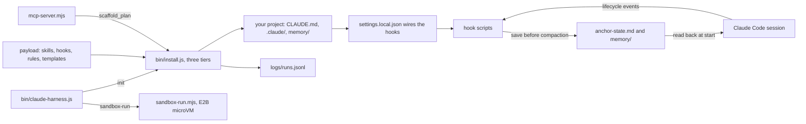

# How Claude Harness works

Claude Harness installs a tested Claude Code setup into any project with one command. A harness is the setup around the model: `CLAUDE.md`, skills, hooks, rules and memory. It comes in three tiers, starter, pro and expert, and each installs more. Its hooks load your project's context at the start of a session and save it before Claude Code compresses the conversation. It is for developers who want a working setup on day one, not a blank folder.

## The parts

[bin/claude-harness.js](../bin/claude-harness.js) is the command line, with `init`, `verify`, `memory-search` and `sandbox-run`. [bin/install.js](../bin/install.js) holds the tiers in `TIERS` and does the install. The payload is what it copies into your project: [skills/](../skills/), [hooks/](../hooks/), [rules/](../rules/), [templates/](../templates/), [examples/](../examples/) and [scripts/](../scripts/). The repository also has its own harness in `.claude/`, `identity/`, `memory/` and `brain/`, which only affects work on this repository. [AGENTS.md](../AGENTS.md) explains the two.

Once installed, `.claude/settings.local.json` wires each hook to a Claude Code event. [hooks/session-start-context.sh](../hooks/session-start-context.sh) loads context when a session starts. [hooks/pre-compact-memory-flush.sh](../hooks/pre-compact-memory-flush.sh) saves the active state before compaction, and [hooks/post-compact-restore.sh](../hooks/post-compact-restore.sh) reads it back after. Inline blockers stop destructive shell commands. Pro and expert also block edits to lockfiles and `.env` files. [mcp-server.mjs](../mcp-server.mjs) is an MCP server: MCP (Model Context Protocol) is the standard way coding agents call outside tools. Its tools are `list_tiers`, `scaffold_plan` and `memory_search`. [lib/sandbox-run.mjs](../lib/sandbox-run.mjs) runs the bash installer, [bin/init.sh](../bin/init.sh), inside an E2B microVM, a small isolated cloud machine.

## What happens when you run it

1. `claude-harness init --tier pro` runs `initCommand` in [bin/claude-harness.js](../bin/claude-harness.js). Flags skip the questions, and any flag you leave out is asked. If the folder already has a harness, it asks before overwriting, or stops when there is no terminal. `--force` skips that check.
2. `install` in [bin/install.js](../bin/install.js) reads the tier and creates `.claude/skills`, `hooks`, `rules` and `backups`. Pro and expert also create `memory/daily`. Expert adds `resources/unread` and `resources/read`.
3. It copies the tier's skills, hook scripts and rules from the payload, and makes the hook scripts executable. A TypeScript or Python project also gets a rule for its language.
4. It writes `.claude/settings.local.json`. Starter gets a minimal file. Pro and expert get [templates/settings.local.json](../templates/settings.local.json) with your project's path filled in.
5. It writes `CLAUDE.md` from the example for your project type, in [examples/](../examples/). It does this only when `CLAUDE.md` is missing or `--force` is set. Memory files are written only when they are missing.
6. It copies the scripts. In a git repository it adds the harness's state files to `.gitignore`. It appends a record to `logs/runs.jsonl` in the package folder.
7. Your next Claude Code session runs the hooks. The start hook injects `CLAUDE.md` state, memory, learnings, recent commits, git status and the skill list. It also re-reads the anchor state when it is under two hours old. [hooks/stop-verify.sh](../hooks/stop-verify.sh) blocks Claude from stopping while more than three files are uncommitted, at most three times a minute. [hooks/session-end-log.sh](../hooks/session-end-log.sh) appends the time and the count of modified files to `memory/daily/`.

## Extending it

- **Know which surface you change.** Top-level [skills/](../skills/), [hooks/](../hooks/) and [rules/](../rules/) are the payload every user receives. `.claude/` only changes how agents work on this repository.
- **A skill, hook or rule.** Add it to the payload folder. To ship it in a tier, add it to that tier in `TIERS` in [bin/install.js](../bin/install.js). Counts move together: update [test/install.test.js](../test/install.test.js), [eval/golden-tasks.json](../eval/golden-tasks.json), [.github/workflows/ci.yml](../.github/workflows/ci.yml), the docs and the README.
- **A hook.** Start it with `#!/bin/bash`, use `$CLAUDE_PROJECT_DIR`, and end `git` and `find` pipelines with `|| true`. Wire it in [templates/settings.local.json](../templates/settings.local.json).
- **A command or MCP tool.** Add a `program.command(...)` in [bin/claude-harness.js](../bin/claude-harness.js), or a tool in [mcp-server.mjs](../mcp-server.mjs).
- **An eval.** Add a task to [eval/golden-tasks.json](../eval/golden-tasks.json) and its check to [eval/run-eval.mjs](../eval/run-eval.mjs).

Then run `pnpm test` and `pnpm run eval`. Install the changed tier into a scratch folder and read what it wrote.

## Questions

**Does it need an API key or cost money?** `init`, `verify`, `memory-search`, the hooks and the MCP server need no key and cost nothing. `sandbox-run` needs `E2B_API_KEY`. The installed `scripts/auto-switch.sh` runs `claude -p`, which uses your own Claude Code plan.

**Does any data leave the machine?** The installer and the hooks work on local files only. `sandbox-run` uploads a small project and part of the payload to an E2B sandbox. The Claude Code sessions you start talk to Anthropic as usual.

**How does it improve itself?** Its [dsip.json](../dsip.json) declares DSIP level L2. Darwin's DSIP checker verifies L2 from the repository. The tests and evals gate pull requests. A daily workflow, [.github/workflows/improve.yml](../.github/workflows/improve.yml), runs [scripts/improve.mjs](../scripts/improve.mjs). It compares eval results with [eval/baseline.json](../eval/baseline.json), lists failing tasks and outdated dependencies, and writes `logs/improve/latest.md`. The workflow then opens one issue labelled `proposal`, or updates the one already open, so a person can review it. A person merges every change.

**How do I run its tests and evals?** Run `pnpm install`. There is no build step. `pnpm test` runs the installer's Vitest tests in [test/install.test.js](../test/install.test.js). `pnpm run eval` runs [eval/run-eval.mjs](../eval/run-eval.mjs): invariants of the payload, live starter, pro and expert installs into scratch folders, then the command line, MCP server, hooks and blockers.

**What does it not do?** It does not run the model or judge your code. It never deletes your files. The settings point at each hook by its absolute path, so they do not follow the project to a new folder. In a folder that is not a git repository, three hooks, `context-monitor.sh`, `post-compact-restore.sh` and `session-end-log.sh`, exit with an error without blocking the session. `npx claude-harness` runs an older npm release, so use the GitHub form in the main README.

## More

- [getting-started.md](getting-started.md): install and first session, step by step.
- [HOOKS.md](HOOKS.md) and [hooks-guide.md](hooks-guide.md): the hook system and how to write a hook.
- [SKILLS.md](SKILLS.md) and [skills-guide.md](skills-guide.md): the skill catalog and how to write a skill.
- [MEMORY-SYSTEM.md](MEMORY-SYSTEM.md): what loads when, and what survives compaction.
- [AUTO-SWITCH.md](AUTO-SWITCH.md): a loop that starts a fresh session when one ends, with its state carried over.
